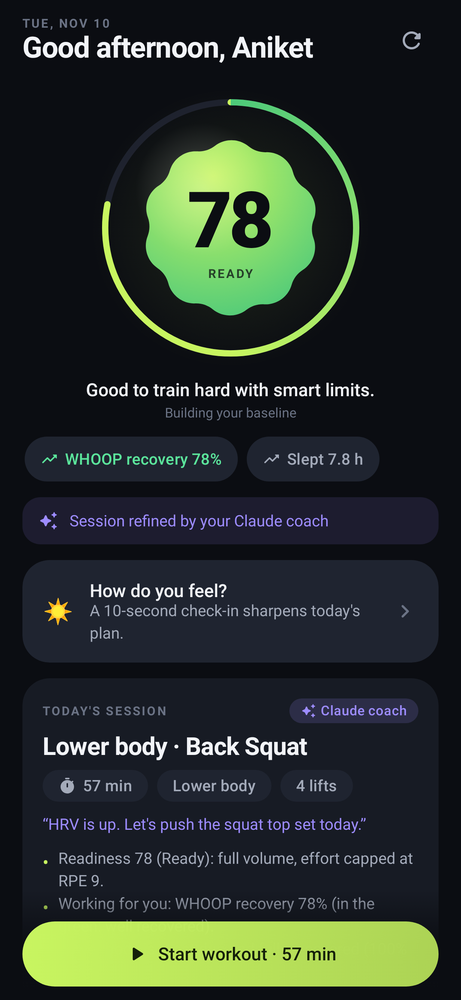
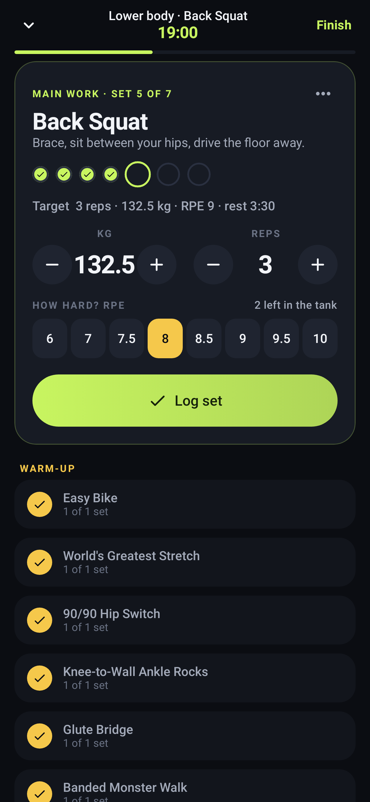
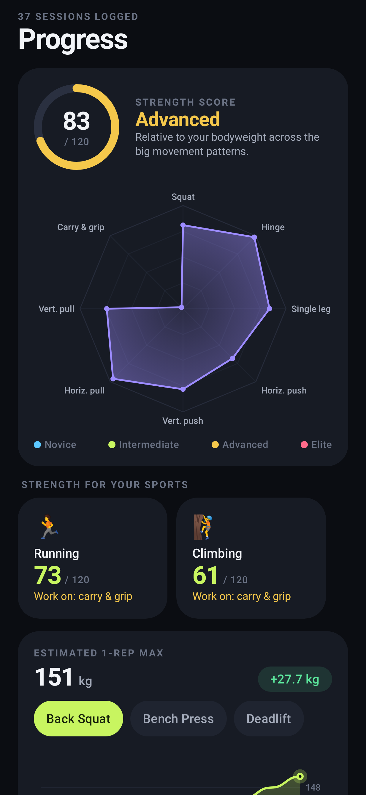
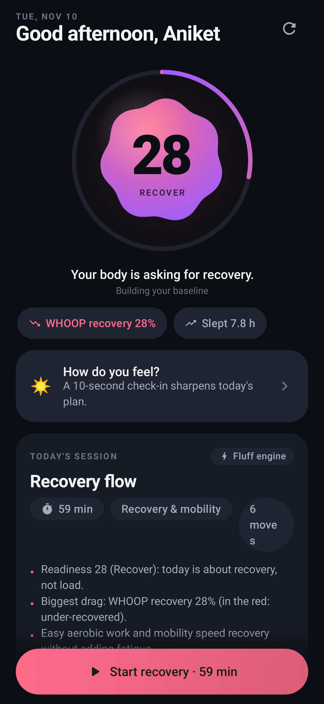
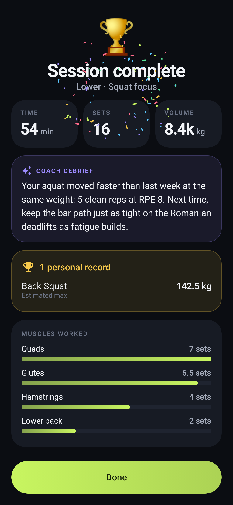
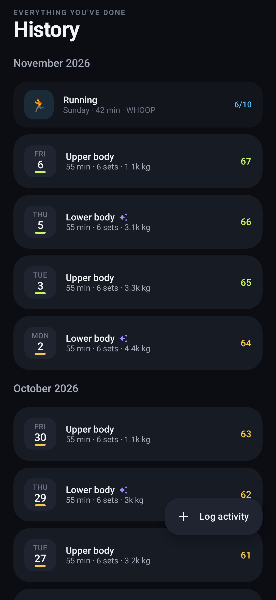
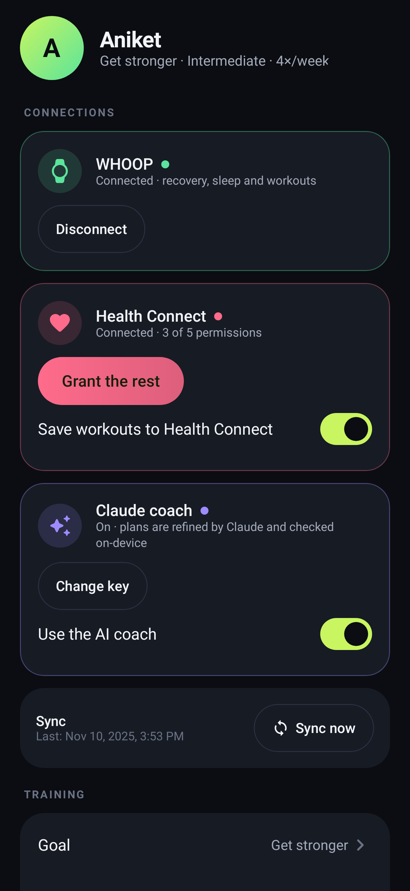

# Fluff

Strength training that listens to your body. Every morning Fluff reads your recovery (WHOOP, or
any wearable that writes to Health Connect such as Fitbit, Pixel Watch, Garmin and Oura), accounts
for your other sports, and designs that day's session from warm-up to cool-down. An optional
Claude coach refines the plan; an on-device validator always has the final say on safety.

| Today | Live workout | Progress |
|---|---|---|
|  |  |  |

| Recovery day | Summary | History | Profile |
|---|---|---|---|
|  |  |  |  |

## What it does

- **Readiness, 0–100.** WHOOP recovery, HRV and resting heart rate against your own 30-day
  baseline, sleep, a 10-second morning check-in, and training load (acute:chronic ratio across
  lifting *and* other sports). Five bands, from Prime to Recover, each with a clear prescription.
- **A plan for today.** Split, exercise choice, sets, reps, RPE and starting loads adapt to
  readiness, muscle freshness, equipment and injuries. Warm-ups and cool-downs are built from what
  you're about to train. Adjust with one tap: shorter, easier, harder, new focus, shuffle.
- **Claude coach (optional).** With your own Anthropic API key, Claude redesigns the session using
  structured outputs constrained to Fluff's exercise library. Fluff validates the result (volume,
  RPE caps, contraindications) and falls back to the engine plan if anything is off.
- **Live workout.** Big steppers, RPE picker, rest timer, set-by-set autoregulation (a set that
  felt much easier or harder nudges the next sets), swap/skip/add, PR celebrations, screen kept on.
- **Progress.** Strength score vs bodyweight standards, a radar across eight movement patterns,
  strength for each of your sports with its limiting pattern, e1RM trends with goal projections,
  weekly volume per muscle, and a consistency heatmap.
- **Private by design.** All data lives on the phone. Secrets are encrypted with Android Keystore
  and excluded from backups. Finished sessions are written back to Health Connect.

## Setup

1. Build: `./gradlew :app:assembleDebug` (JDK 21, Android SDK with platform 37).
2. **Health Connect:** connect from onboarding or Profile.
3. **WHOOP:** WHOOP requires every app to be registered. Create an app at
   [developer.whoop.com](https://developer.whoop.com) with redirect URL `fluff://oauth/whoop` and
   the read scopes, then paste the client ID and secret into Profile → WHOOP (or put
   `WHOOP_CLIENT_ID` / `WHOOP_CLIENT_SECRET` in an uncommitted `secrets.properties` for local builds).
4. **Claude coach:** add an API key from [console.anthropic.com](https://console.anthropic.com) in
   Profile → Claude coach.

## Project layout

- `core/` pure Kotlin, no Android: readiness, planner, load advice, strength scores, goals, the AI
  contract and plan validator. Fully unit-tested.
- `app/` Android: Room + DataStore, Keystore secrets, WHOOP / Health Connect / Claude integrations,
  sync worker, Compose UI with custom Canvas charts and a morphing readiness orb.

See [docs/ARCHITECTURE.md](docs/ARCHITECTURE.md) for the design.

## Tests

```
./gradlew :core:test :app:testDebugUnitTest   # engine, repository, WHOOP client, coach engine, screenshots
./gradlew :app:recordRoborazziDebug           # refresh app/screenshots
```
